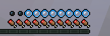
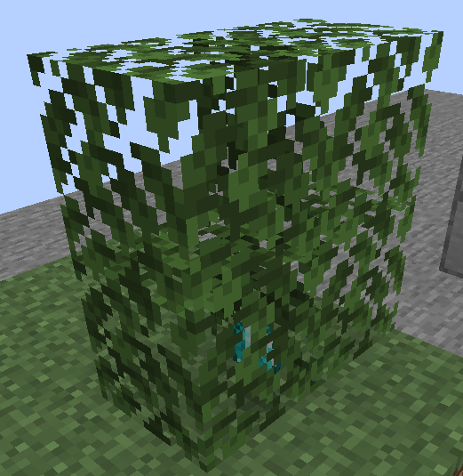
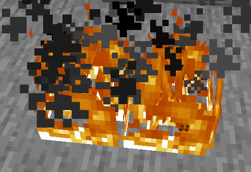
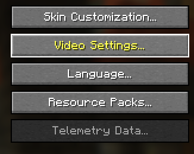

# Alteration

 

**Alteration** is a Minecraft mod focused on adding random tweaks, visual changes, small backports and etc. Useful for modpacks!

## Features
### Oxygen Bar Backport (<=1.21.1)
Backported 1.21.2+ oxygen bar update, as well as backporting bubble pop sound (both are configurable). Supports [Raised](https://modrinth.com/mod/raised)! 

---

### "Terraria" Lighting **[REQUIRES SODIUM]**
Terraria-like lighting system, which mixes both flat and smooth lighting (Strength is configurable).

---

### Item-Passable Blocks
Items can now pass through blocks like leaves (Configurable with block tag).

---

### Fire-Immune Items
Some items are immune to fire now! (Doesn't mean they're immune to lava) By default includes Blaze Rod/Powder (Configurable with item tag).

---

### Hover Text Color
You can now change default text hover text! By default it's Yellow.

---

### Easy Replacing
Now you can replace flowers and other similar blocks with other blocks more easily (Configurable with block tag). 

---

### Heal Sound
Original feature, plays a new healing sound when health goes up.
