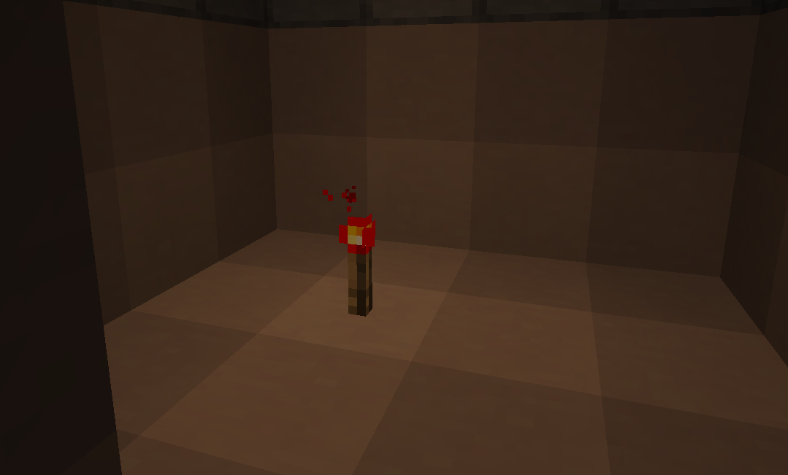

# Alteration

 

**Alteration** is a multi-platform Minecraft mod focused on adding random tweaks, visual changes, small backports and etc. Useful for modpacks!

## Features
### Oxygen Bar Backport (<=1.21.1)
Backported 1.21.2+ oxygen bar update, as well as backporting bubble pop sound (both are configurable). Supports Raised! 

---

### "Terraria" Lighting **[REQUIRES SODIUM]**
Terraria-like lighting system, which mixes both flat and smooth lighting (Strength is configurable)

---

### Heal Sound
Original feature, plays a new healing sound when health goes up.
